## Tech Stack

  
  
  
  

  

## GitHub Stats

  
  

  

## DAILY-STUDY

> 매일 **AI·DA**와 **Backend** 분야에서 핵심 개념을 하나씩 학습합니다.

<!-- DAILY_STUDY:START -->
### Study Dashboard

| 🔥 현재 스트릭 | 🏆 최장 스트릭 | 📅 완료한 학습일 | 🧠 완료한 질문 | 🔁 복습 |
|---:|---:|---:|---:|---:|
| **2일** | **6일** | **48일** | **75개** | **0회** |

#### 최근 학습

| 날짜 | AI·DA | Backend |
|---|---|---|
| 2026-10-29 | [인코더 전용·디코더 전용·인코더-디코더 트랜스포머와 크로스 어텐션](https://github.com/sebalnakji/DAILY-STUDY/blob/main/notes/2026/2026-10-29-ai-data-encoder-decoder.md) | - |
| 2026-10-28 | [선형 판별 분석(LDA, Linear Discriminant Analysis)](https://github.com/sebalnakji/DAILY-STUDY/blob/main/notes/2026/2026-10-28-ai-data-lda.md) | - |
| 2026-10-13 | [CNN 분류 아키텍처의 흐름 — AlexNet에서 EfficientNet까지](https://github.com/sebalnakji/DAILY-STUDY/blob/main/notes/2026/2026-10-13-ai-data-cnn-architectures.md) | - |
| 2026-10-12 | [층 정규화(Layer Normalization)와 RMSNorm — 배치 정규화와의 비교](https://github.com/sebalnakji/DAILY-STUDY/blob/main/notes/2026/2026-10-12-ai-data-layer-norm.md) | - |
| 2026-10-08 | [로지스틱 회귀의 비용 함수와 교차 엔트로피(Cross-Entropy)](https://github.com/sebalnakji/DAILY-STUDY/blob/main/notes/2026/2026-10-08-ai-data-logistic-cross-entropy.md) | - |
<!-- DAILY_STUDY:END -->
